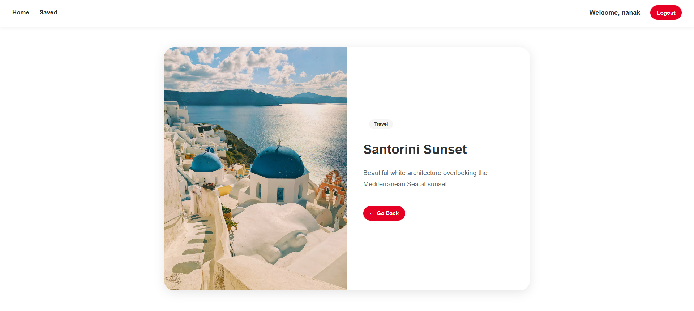
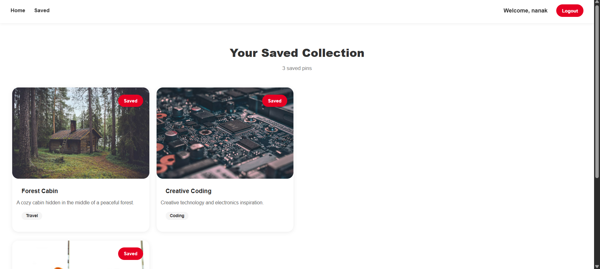
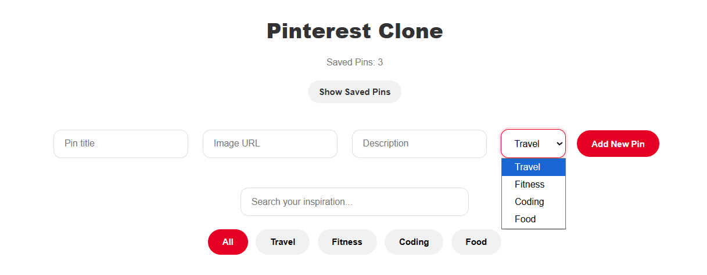
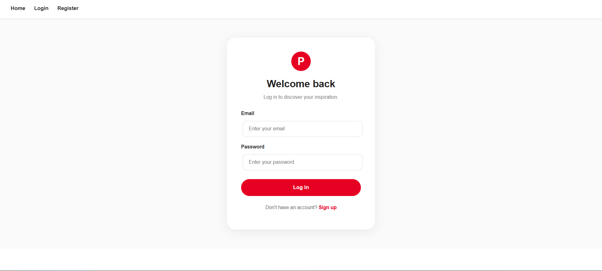
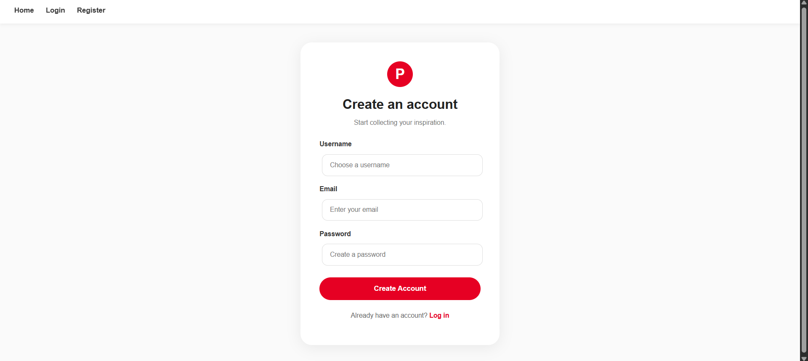

# Pinterest Clone

A full-stack Pinterest-inspired web application built using React, TypeScript, Node.js, Express, and PostgreSQL.

Users can create accounts, manage their own pins, explore inspiration, search and filter content, and save pins to personal collections.

---

## Screenshots

### Home Page
The main dashboard featuring navigation, pin creation, search, category filters, and a Pinterest-inspired layout.


### Pin Grid & Discovery
A responsive masonry-style grid displaying pins across different categories.


### Pin Details
An individual pin page displaying its image, title, description, and category.



### Saved Collection
A dedicated page displaying pins saved by the logged-in user.



### Pin Creation, Search & Filtering
Interactive functionality for creating pins, selecting categories, and exploring content through filters.

This was one of the most challenging parts of the project because it required connecting multiple frontend components, application state, and backend functionality. Working through the implementation and debugging process helped me understand how these pieces interact. I can now approach similar functionality much faster and with greater confidence.



### Authentication

**Login Page**



**Registration Page**



---

## Features

### Authentication & Security
- User registration and login.
- JWT-based authentication.
- Password hashing using bcrypt.
- Protected routes.
- User-specific data and permissions.

### Pin Management
- Create pins using a title, image URL, description, and category.
- Edit existing pins.
- Delete pins.
- View individual pin details.
- Pins are associated with their creators.

### Search & Discovery
- Search pins by title and description.
- Filter pins by category:
  - Travel
  - Fitness
  - Coding
  - Food

### Saved Collections
- Save and unsave pins.
- Dedicated saved pins page.
- User-specific collections.
- Database constraint preventing duplicate saves.

### Responsive UI
- Responsive layouts for desktop, tablet, and mobile.
- Pinterest-inspired masonry layout.
- Interactive components and navigation.

---

## Tech Stack

### Frontend
- React
- TypeScript
- React Router
- CSS

### Backend
- Node.js
- Express.js
- REST APIs
- JWT
- bcrypt
- Helmet
- Express Rate Limit

### Database
- PostgreSQL
- pg (node-postgres)

### Tools
- Git & GitHub
- Postman
- pgAdmin
- VS Code

---

## Project Structure

```text
Pinterest-Clone/
│
├── public/
├── screenshots/
│   ├── home.png
│   ├── pin-grid.png
│   ├── pin-details.png
│   ├── saved.png
│   ├── functionality.png
│   ├── login.png
│   └── register.png
│
├── src/
│   ├── components/
│   │   ├── AuthContext.tsx
│   │   ├── Home.tsx
│   │   ├── Login.tsx
│   │   ├── Pin.tsx
│   │   ├── PinContext.tsx
│   │   ├── PinDetail.tsx
│   │   ├── PinForm.tsx
│   │   ├── ProtectedRoute.tsx
│   │   ├── Register.tsx
│   │   └── Saved.tsx
│   │
│   ├── App.tsx
│   ├── index.tsx
│   └── styles.css
│
├── server/
│   ├── db.js
│   ├── index.js
│   ├── package.json
│   └── test-db.js
│
├── .gitignore
├── package.json
└── README.md
```

---

## Getting Started

Follow these instructions to run the project locally.

### Prerequisites

Make sure you have installed:

- Node.js and npm
- PostgreSQL
- pgAdmin (optional)

### 1. Clone the Repository

```bash
git clone https://github.com/NanakRPatvardhan/Pinterest-Clone.git
```

Navigate into the project directory:

```bash
cd Pinterest-Clone
```

### 2. Set Up the Database

Create a PostgreSQL database named:

```sql
CREATE DATABASE pinterest_clone;
```

Connect to the database and execute the following SQL:

```sql
CREATE TABLE users (
    id SERIAL PRIMARY KEY,
    username VARCHAR NOT NULL,
    email VARCHAR UNIQUE NOT NULL,
    password_hash TEXT NOT NULL,
    created_at TIMESTAMP DEFAULT CURRENT_TIMESTAMP
);

CREATE TABLE pins (
    id SERIAL PRIMARY KEY,
    title VARCHAR NOT NULL,
    image TEXT NOT NULL,
    description TEXT NOT NULL,
    category VARCHAR NOT NULL,
    created_at TIMESTAMP DEFAULT CURRENT_TIMESTAMP,
    updated_at TIMESTAMP DEFAULT CURRENT_TIMESTAMP,
    user_id INTEGER NOT NULL REFERENCES users(id),

    CONSTRAINT pins_title_not_empty
    CHECK (LENGTH(TRIM(title)) > 0),

    CONSTRAINT pins_other_fields_not_empty
    CHECK (
        LENGTH(TRIM(image)) > 0 AND
        LENGTH(TRIM(description)) > 0 AND
        LENGTH(TRIM(category)) > 0
    )
);

CREATE TABLE saved_pins (
    id SERIAL PRIMARY KEY,
    pin_id INTEGER NOT NULL REFERENCES pins(id),
    user_id INTEGER NOT NULL REFERENCES users(id),

    CONSTRAINT saved_pins_user_pin_unique
    UNIQUE (user_id, pin_id)
);
```

### 3. Configure Environment Variables

Inside the `server` directory, create a `.env` file.

Add your PostgreSQL credentials and JWT secret:

```env
DB_USER=your_postgres_username
DB_HOST=localhost
DB_NAME=pinterest_clone
DB_PASSWORD=your_postgres_password
DB_PORT=5432

JWT_SECRET=your_secure_random_secret
```

Replace the placeholder values with your local configuration.

**Important:** Never upload your `.env` file or expose database credentials or JWT secrets.

### 4. Install Dependencies

Install the frontend dependencies from the project root:

```bash
npm install
```

Install backend dependencies:

```bash
cd server
npm install
```

### 5. Start the Backend

From the `server` directory, run:

```bash
node index.js
```

The backend runs at:

```text
http://localhost:5000
```

### 6. Start the Frontend

Open a second terminal, navigate to the project root, and run:

```bash
npm start
```

The frontend runs at:

```text
http://localhost:3000
```

You can now register an account and start using the application.

---

## Database Design

The application uses three PostgreSQL tables.

| Table | Purpose |
|---|---|
| `users` | Stores registered user accounts and password hashes. |
| `pins` | Stores pins created by users. |
| `saved_pins` | Stores user-specific saved pin relationships. |

### Relationships

- Each pin belongs to a user.
- Each saved pin references both a user and a pin.
- A user cannot save the same pin more than once.
- User-specific data is associated with authenticated accounts.

---

## What I Learned

Building this project helped me gain practical experience with:

- First of all it took me more than 20 hours to complete the whole app ;/ ,
- but i did and gained whole new experience :) ,
- i can build this ass many times as i want now.  
- Connecting a React frontend to a Node.js backend.
- Building and working with REST APIs.
- Implementing authentication using JWT.
- Hashing passwords with bcrypt.
- Managing application state using React Context.
- Working with PostgreSQL and relational database constraints.
- Implementing CRUD functionality.
- Handling user-specific data.
- Debugging frontend/backend integration issues.
- Building responsive interfaces.
- Using Git and GitHub to manage a project.

Some of the most challenging parts were connecting authentication, database ownership, saved pins, and frontend state so they worked together correctly. Debugging these issues helped me understand how the different layers of a full-stack application interact.

---

## Future Improvements

- Currently I have jumped into AI and cloud will see how I can use those features into the app. 
- I do have plans of use third party APIS to implement live Pinterest pins into the app I am looking into it.  
- Image uploading and cloud storage.
- Public discovery feed across multiple users.
- Additional social features.
- Deployment to a production environment.
- Improved UI and animations.

---

## Author

**Nanak Patvardhan**

GitHub: [NanakRPatvardhan](https://github.com/NanakRPatvardhan)
